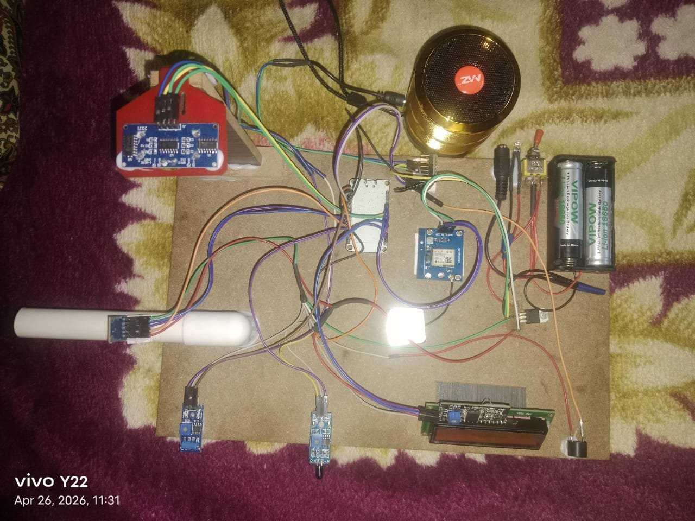
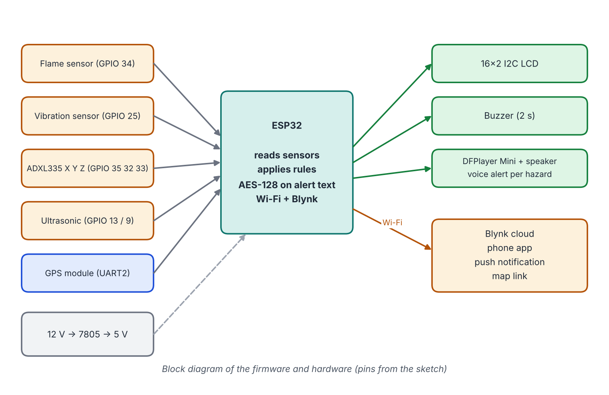
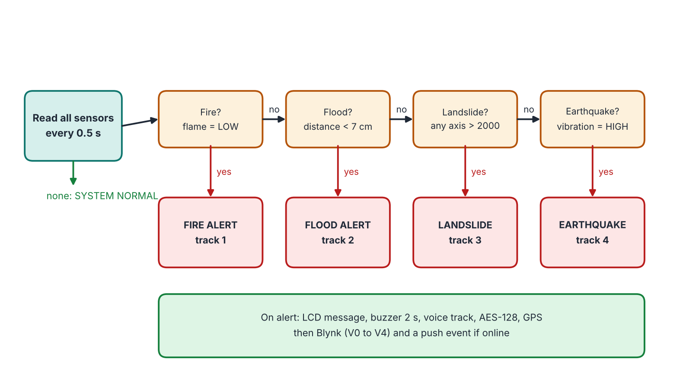

# Low-Cost AI-Integrated Embedded Disaster Response System

An ESP32 early-warning prototype that watches for fire, flood, landslide and earthquake-like shaking. It shows the alert on an LCD, sounds a buzzer, plays a voice message, and sends the alert with a GPS location to a Blynk mobile app. If Wi-Fi is down it keeps working locally.

Final-year B.E. (Electronics and Communication Engineering) team project, Loyola Institute of Technology and Science, Anna University, May 2026.

## The prototype



The board on a wooden base: ultrasonic sensor on a red mount (top left), two sensor modules and the ADXL335 (bottom left), GPS module (centre), I2C LCD (bottom), buzzer, speaker, two 18650 cells with a switch and a 7805 regulator (right).

## What it does

| Hazard | Sensor | Trigger in the firmware |
| --- | --- | --- |
| Fire | IR flame sensor | digital output goes LOW |
| Flood | Ultrasonic sensor | distance under 7 cm |
| Landslide | ADXL335 accelerometer | any axis above 2000 (ADC) |
| Earthquake | Vibration sensor | digital output HIGH |

On an alert the device:
1. shows the alert on a 16x2 I2C LCD,
2. sounds a buzzer for 2 seconds,
3. plays a voice message from a DFPlayer Mini (one track per hazard),
4. reads its location from a GPS module,
5. encrypts the alert text with AES-128 and sends it, the plain text, the latitude, the longitude and a Google Maps link to Blynk,
6. logs a Blynk event so the phone gets a push notification.

The board shows ONLINE or OFFLINE mode on the LCD and reconnects to Wi-Fi every few seconds. When offline, the LCD, buzzer and voice alert still work.

## Block diagram





Text version:

```
 Flame ------+
 Vibration --+
 ADXL335 ----+--> ESP32 --+--> LCD 16x2 (I2C)
 Ultrasonic -+     |  |    +--> Buzzer
 GPS --------+     |  |    +--> DFPlayer Mini + speaker (voice alert)
                   |  |
                   |  +--(Wi-Fi)--> Blynk cloud --> phone app + push notification
 12 V -> 7805 -> 5 V power
```

## Repository

| Path | Content |
| --- | --- |
| `firmware/` | Arduino sketch, pin map, setup steps |
| `app/` | Android companion app (APK, built with MIT App Inventor) |
| `docs/hardware.md` | components and power supply |
| `docs/working.md` | detection and alert flow |
| `docs/testing-and-results.md` | bench tests and observations |
| `docs/limitations-and-future-work.md` | limits and next steps |
| `docs/references.md` | literature |

## Honest scope

The firmware uses fixed thresholds. The project report also proposes AI-assisted anomaly detection to cut false alarms; that part is future work and is not in this firmware. Tests were bench simulations, not a field trial.

## License

MIT. See `LICENSE`.
